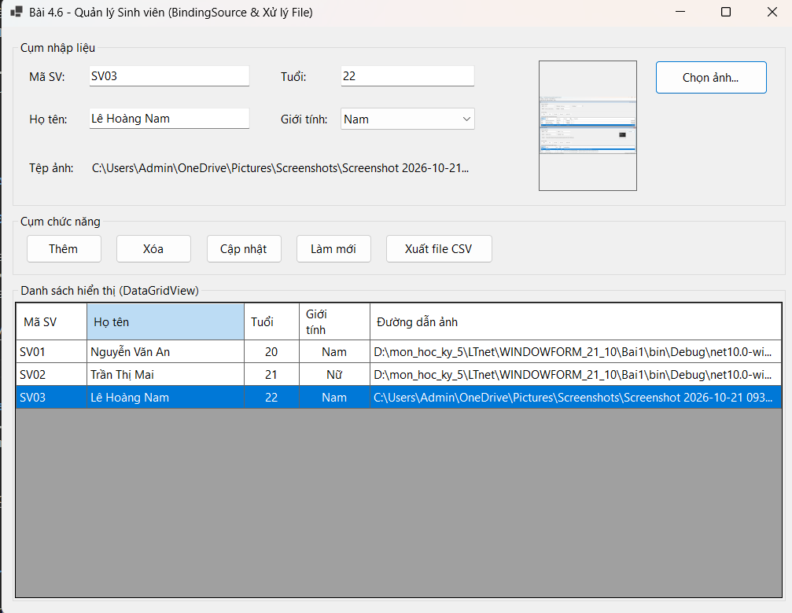
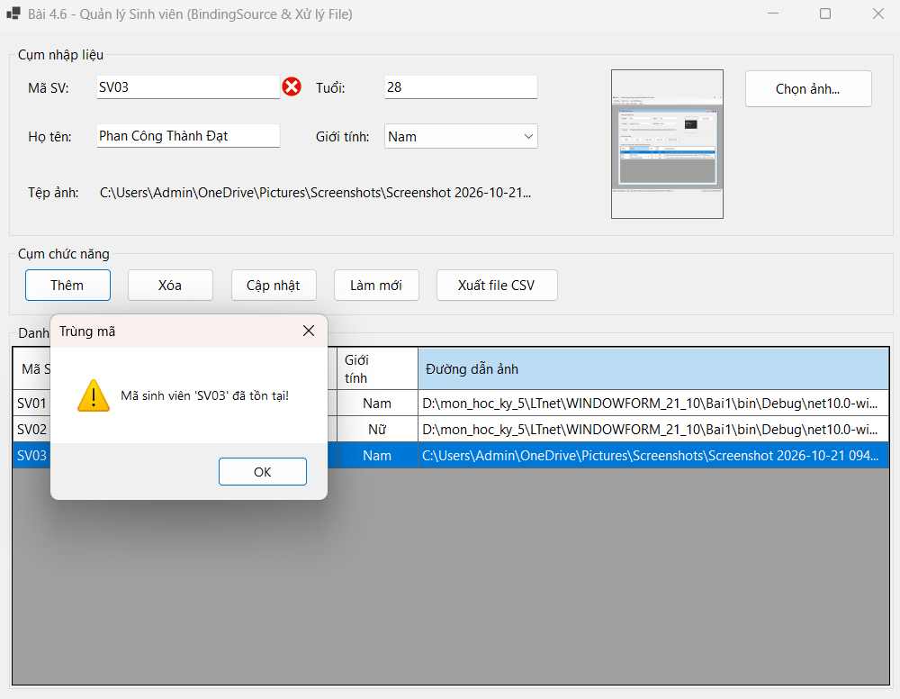
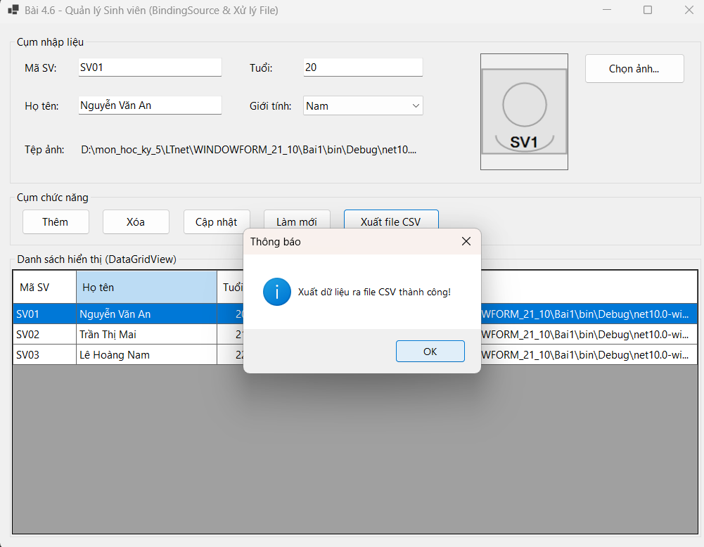
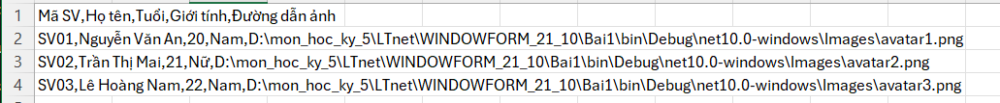

## THÔNG TIN SINH VIÊN
- **Họ và tên:** Phan Công Thành Đạt
- **Mã số sinh viên:** 24810310223
- **Lớp:** D19CNPM3
- **Tên môn học:** Lập trình .NET / Windows Forms
- **Tên bài tập:** Bài 4.6: Quản lý dữ liệu với BindingSource & Xử lý file (Avatar / CSV)

---

## DANH SÁCH ẢNH CHỤP MINH HỌA KẾT QUẢ

### 1. Giao diện khởi động & Đồng bộ dữ liệu 2 chiều (BindingSource)

---

### 2.Bắt lỗi Validation (ErrorProvider)

---

### 3.Xuất file CSV (SaveFileDialog)

---
