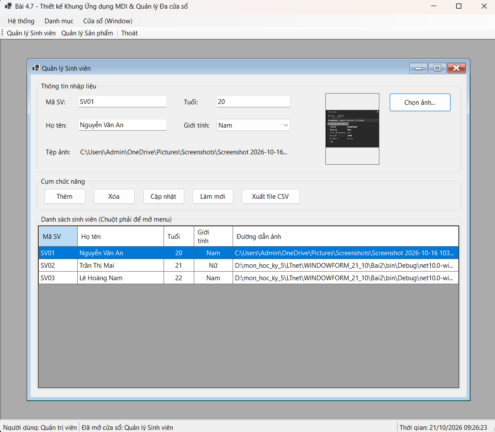
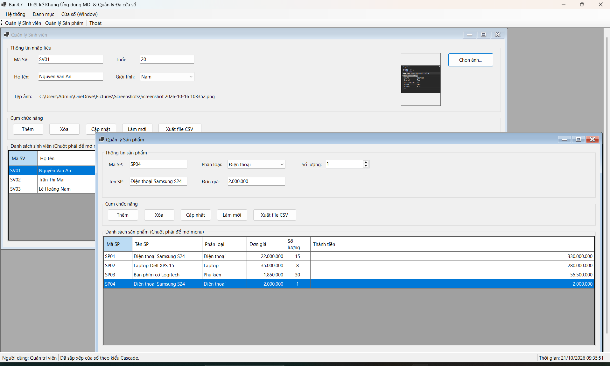
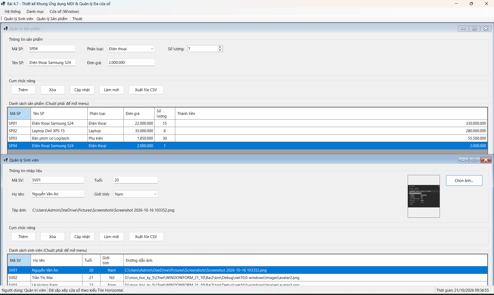
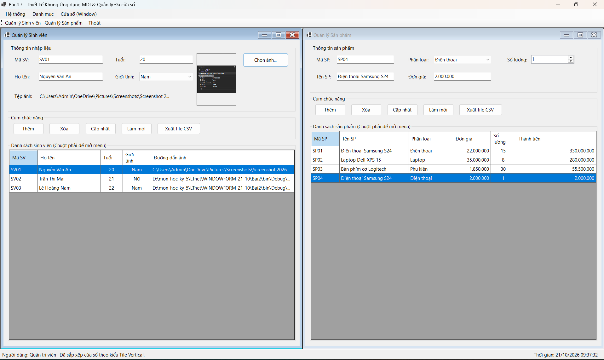
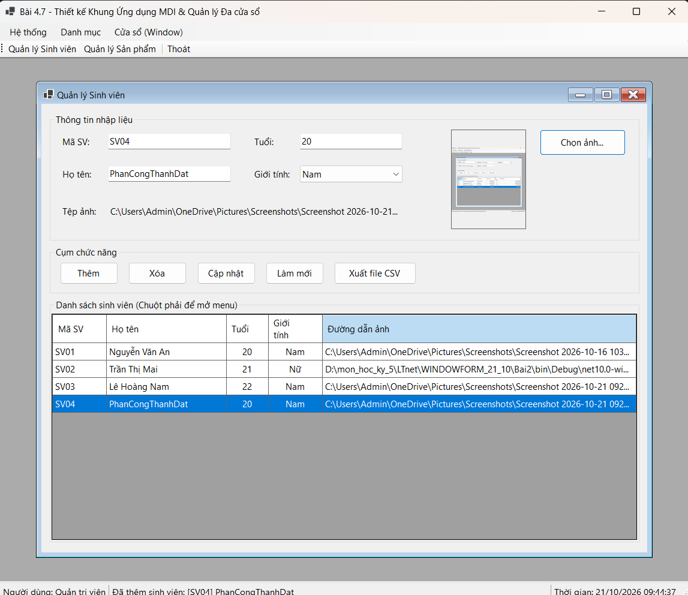
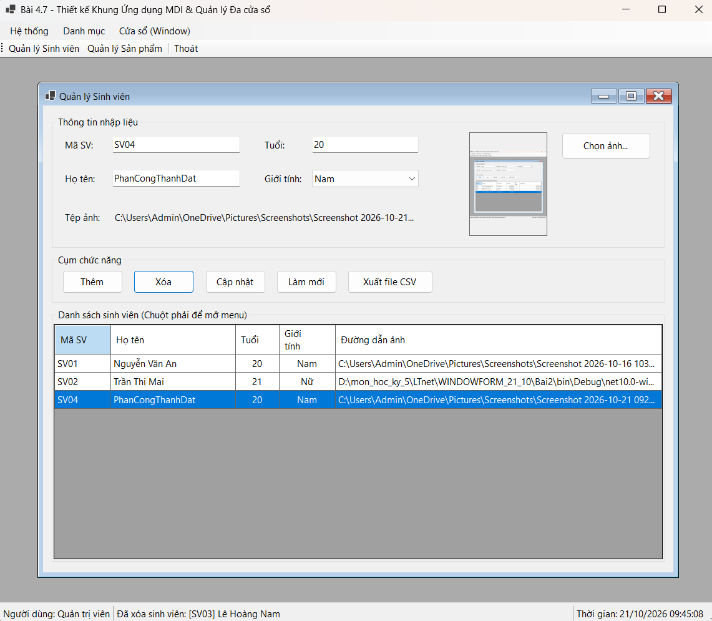
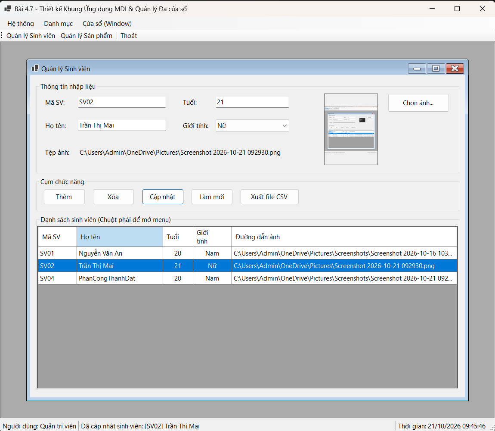
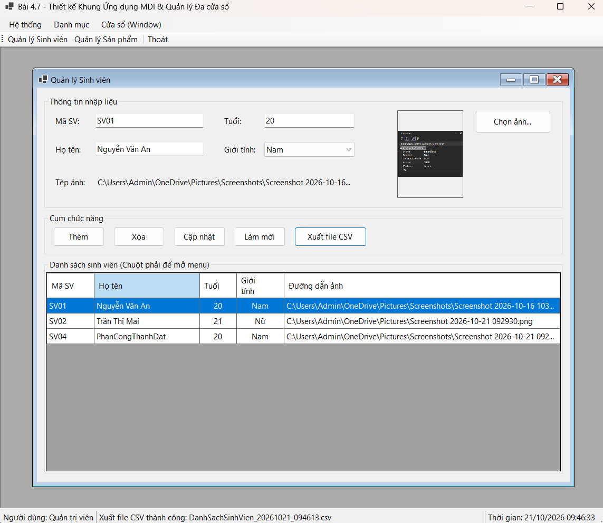

## THÔNG TIN SINH VIÊN
- **Họ và tên:** Phan Công Thành Đạt
- **Mã số sinh viên:** 24810310223
- **Lớp:** D19CNPM3
- **Tên môn học:** Lập trình .NET / Windows Forms
- **Tên bài tập:** Bài 4.7: Thiết kế khung ứng dụng MDI & Quản lý đa cửa sổ

---

## DANH SÁCH ẢNH CHỤP MINH HỌA KẾT QUẢ

### 1. Khung chính MDI Parent (FormMain)

---

### 2. Quản lý MDI Child & Chống mở trùng Form

 

---

### 3. Sắp xếp cửa sổ (Window Layout: Cascade / Tile)

**chọn sắp xếp Cascade**

**chọn sắp xếp Tile Horizontal**

**chọn sắp xếp Tile Vertical**

---

### 4. Giao tiếp MDI Parent - Child & ContextMenuStrip

